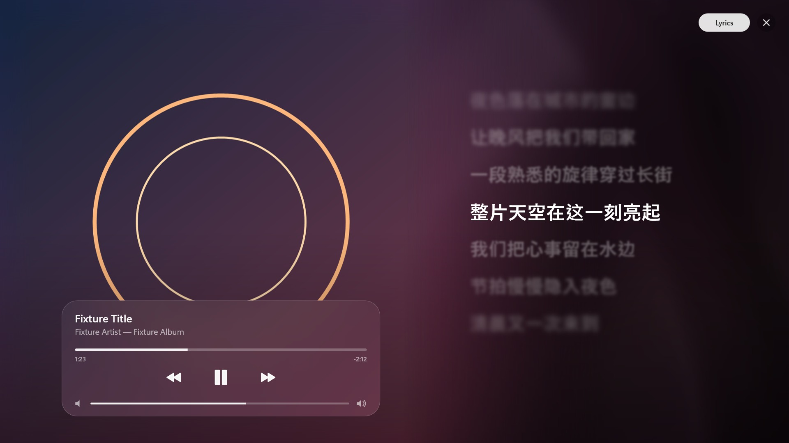
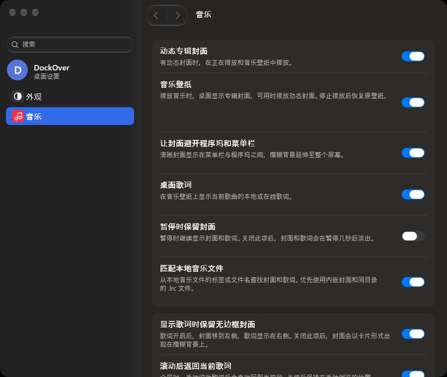

# DockOver Music Player

让专辑封面随正在播放的音乐成为 Windows 壁纸，并在桌面或全屏显示同步歌词。可用时播放动态专辑封面，封面颜色驱动歌词后方的丝绸律动背景。

## Windows 11 x64

解压 `DockOver-Music-Player-Windows-Portable-0.1.0.zip`，运行 `DockOverMusic.exe`。从通知区域打开「音乐壁纸」「桌面歌词」「正在播放」或「音乐设置」。请照常用支持 Windows 媒体控制的播放器播放音乐。

设置支持封面布局、歌词时间、LRC 文件、动态封面、帧率、律动响应、快捷键和简体中文。如果同时运行 DockOver，两个入口共用壁纸实例和音乐设置。

[下载 0.1.0](https://github.com/Davizcbia/DockOver-Music-Player/releases/tag/0.1.0) · [共享源码](https://github.com/Davizcbia/DockOver/tree/1.1.0/dockui/src/now_playing)

## 功能截图

| 无边框封面和歌词 | 卡片歌词 |
| --- | --- |
|  |  |
| **16:10 桌面歌词** | **简体中文音乐设置** |
|  |  |

截图使用演示封面和歌词。16:9 与 16:10 的离屏画面已覆盖 720p 至 4K 级别。混合 DPI 双屏、4K 动态壁纸性能和竖屏歌词布局仍在测试。
