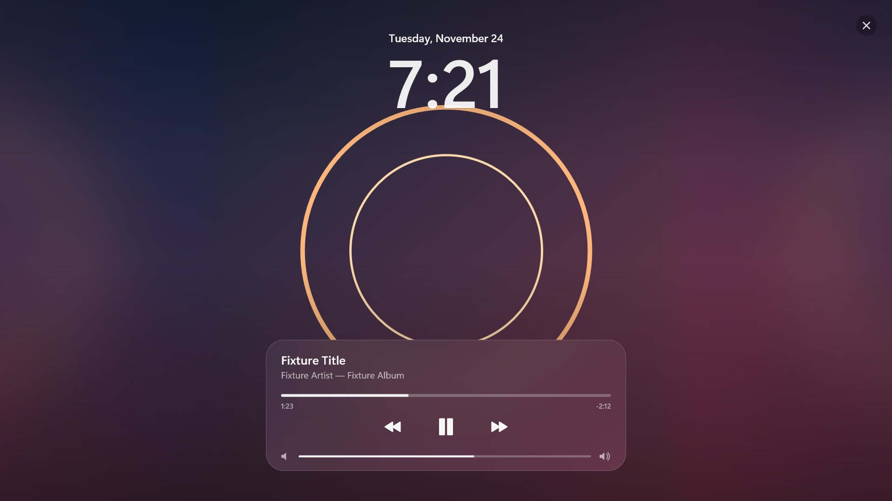
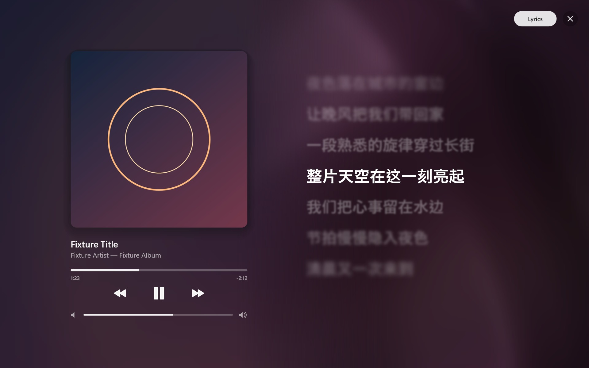
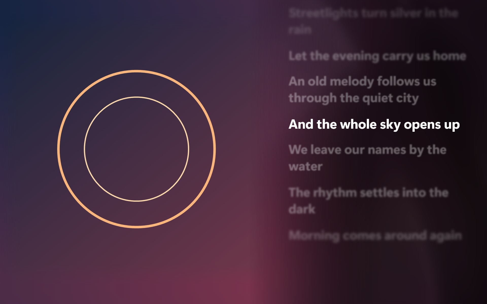

# DockOver Music Player

[简体中文](#简体中文) · [English](#english)

## 简体中文

让专辑封面随正在播放的音乐成为 Windows 壁纸，并在桌面或全屏显示同步歌词。可用时播放动态专辑封面，封面颜色驱动歌词后方的丝绸律动背景。

## Windows 11 x64

解压 `DockOver-Music-Player-Windows-Portable-0.1.0.zip`，运行 `DockOverMusic.exe`。从通知区域打开「音乐壁纸」「桌面歌词」「正在播放」或「音乐设置」。请照常用支持 Windows 媒体控制的播放器播放音乐。

设置支持封面布局、歌词时间、LRC 文件、动态封面、帧率、律动响应、快捷键和简体中文。如果同时运行 DockOver，两个入口共用壁纸实例和音乐设置。

[下载 0.1.0](https://github.com/Davizcbia/DockOver-Music-Player/releases/tag/0.1.0) · [共享源码](https://github.com/Davizcbia/DockOver/tree/1.1.0/dockui/src/now_playing)

截图使用演示封面和歌词。16:9 和 16:10 静态画面已覆盖 720p 至 4K 级别，混合 DPI、4K 动态播放和竖屏歌词仍在测试。

## English

DockOver Music Player brings current album artwork and synchronized lyrics to your Windows desktop and to full-screen Now Playing. It can show motion artwork when available and use the cover palette for the music-reactive silk background.

Extract the Windows 11 x64 package and run `DockOverMusic.exe`. Use the notification-area icon for Music Wallpaper, Desktop Lyrics, Now Playing, or Music Settings. Play music with an existing Windows media player.

Settings include artwork layouts, lyric timing, local LRC files, motion artwork, frame rate, music response, shortcuts, and Simplified Chinese. If the DockOver suite is running, both entry points share the wallpaper instance and music settings.

Screenshots use sample cover art and lyrics. Static 16:9 and 16:10 rendering was checked from 720p through 4K-class resolutions. Mixed-DPI displays, sustained 4K motion playback, and portrait lyrics are still being tested.

[Download 0.1.0](https://github.com/Davizcbia/DockOver-Music-Player/releases/tag/0.1.0) · [Shared source](https://github.com/Davizcbia/DockOver/tree/1.1.0/dockui/src/now_playing)

## 功能截图 / Screenshots

| 无边框封面和歌词 / Borderless lyrics | 卡片歌词 / Card layout |
| --- | --- |
|  |  |
| **16:10 桌面歌词 / 16:10 desktop lyrics** | **简体中文音乐设置 / Music settings in Chinese** |
|  |  |
